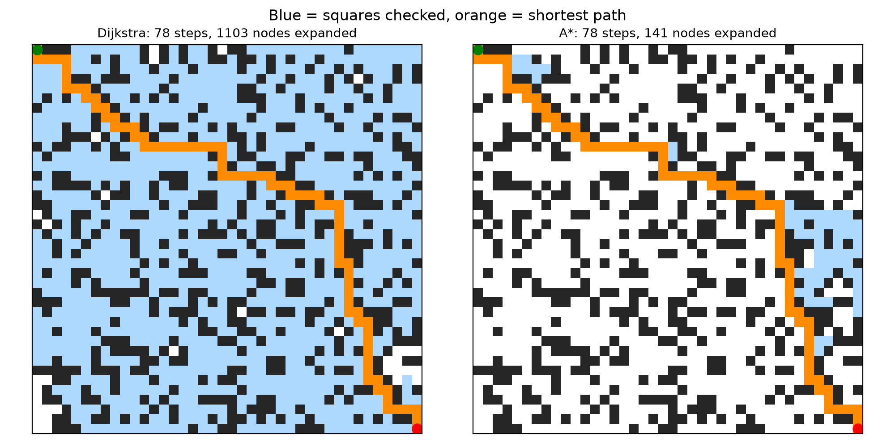
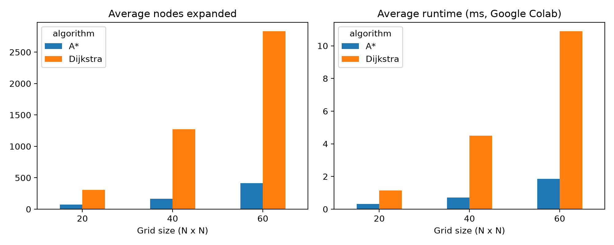
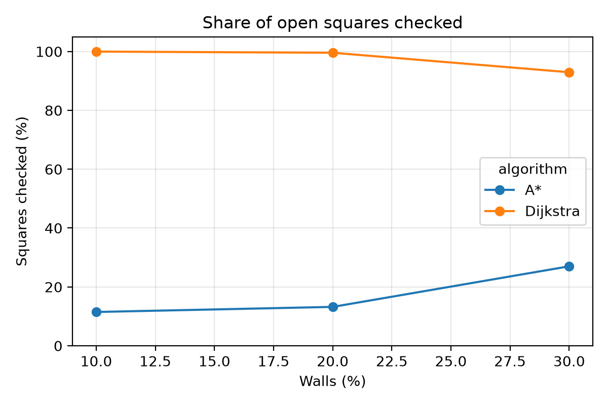

# Grid Pathfinding: A* vs Dijkstra (from scratch)

A search engine that lets a virtual agent find the shortest route through grid mazes.
**Dijkstra's algorithm** and **A\* search** are implemented from scratch in Python (no pathfinding libraries),
tested on 45 random mazes, and compared on path length, runtime and nodes expanded.
Built as Task 3 of the Progree Remote Internship in Artificial Intelligence.



*Blue = cells the algorithm checked, orange = shortest path. Both find the same 78-step path,
but Dijkstra expands 1,103 cells while A\* expands only 141.*

## Results

Averages over 5 solvable mazes per setting (runtimes measured in Google Colab):

| Grid | Walls | Path steps | Expanded: Dijkstra | Expanded: A* | Runtime Dijkstra / A* (ms) |
|---|---|---|---|---|---|
| 20x20 | 10% | 38.0 | 362.2 | 61.4 | 1.57 / 0.34 |
| 20x20 | 20% | 38.0 | 322.8 | 59.6 | 1.10 / 0.25 |
| 20x20 | 30% | 40.0 | 237.6 | 94.6 | 0.74 / 0.36 |
| 40x40 | 10% | 78.0 | 1,441.4 | 120.6 | 5.62 / 0.57 |
| 40x40 | 20% | 78.0 | 1,269.0 | 143.2 | 4.31 / 0.62 |
| 40x40 | 30% | 79.6 | 1,102.4 | 230.4 | 3.57 / 0.93 |
| 60x60 | 10% | 118.0 | 3,224.0 | 294.4 | 12.75 / 1.45 |
| 60x60 | 20% | 118.0 | 2,846.4 | 285.8 | 11.24 / 1.27 |
| 60x60 | 30% | 121.2 | 2,432.0 | 666.0 | 8.70 / 2.84 |

- Both algorithms always find the **same shortest path** (A\* with the Manhattan heuristic is optimal).
- A\* expands **85% fewer nodes** than Dijkstra overall and is about **6x faster** on 60x60 mazes.
- A simple **tie-breaking** rule (prefer the cell closer to the goal when scores are equal) cut A\*'s expansions by 77%.

| | |
|---|---|
|  |  |

Every run is logged in [results/pathfinding_log.csv](results/pathfinding_log.csv) (runtimes in this file come from a separate run, so they differ slightly from Colab).
The full write-up is in [report/Task3_Pathfinding_Report.pdf](report/Task3_Pathfinding_Report.pdf).

## How it works

- **Grid:** N x N cells, 0 = free and 1 = wall, walls placed randomly with a fixed seed. The agent moves up, down, left or right at cost 1.
- **Dijkstra:** expands cells in order of distance from the start, g(n).
- **A\*:** expands cells in order of f(n) = g(n) + h(n), where h(n) is the Manhattan distance to the goal. Ties are broken by the smaller h(n).
- One function, `search(grid, start, goal, use_heuristic)`, implements both (h = 0 gives Dijkstra), using `heapq` as the priority queue.

## How to run

**Google Colab:** open `pathfinding.ipynb` and run all cells.

**Locally:**

```bash
pip install -r requirements.txt
python pathfinding.py
```

## Project structure

```
pathfinding.ipynb    notebook version (step by step)
pathfinding.py       same code as a script
results/             path visualization, charts and the CSV log of all runs
report/              full PDF report
```

## Author

Darakhshan Mujtaba, Progree AI Internship (2026)
